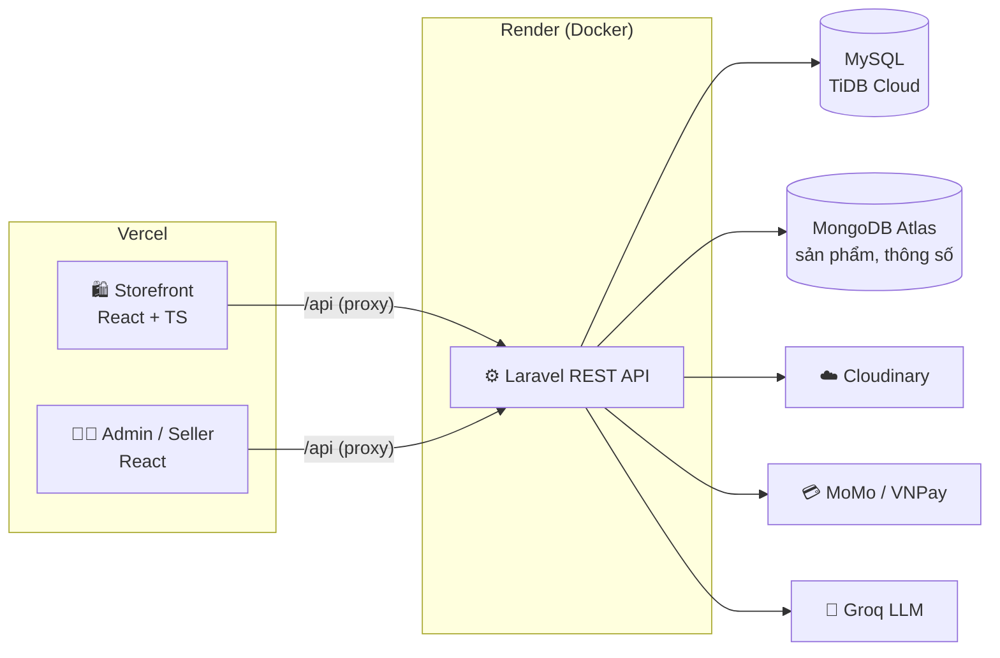
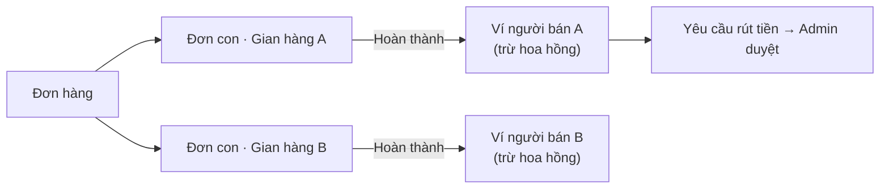

<div align="center">

# 🛒 ShopTech

**Sàn thương mại điện tử đa gian hàng bán đồ công nghệ: điện thoại, laptop, điện máy**

Khách hàng mua sắm · Người bán mở gian hàng · Quản trị viên vận hành sàn

[](https://shoptech-sandy.vercel.app)
[](https://shoptech-admin01.vercel.app)


</div>

---

## 📑 Mục lục

- [Giới thiệu](#-giới-thiệu)
- [Demo](#-demo)
- [Tính năng chính](#-tính-năng-chính)
- [Công nghệ sử dụng](#-công-nghệ-sử-dụng)
- [Kiến trúc hệ thống](#-kiến-trúc-hệ-thống)
- [Cấu trúc thư mục](#-cấu-trúc-thư-mục)
- [Cài đặt & chạy local](#-cài-đặt--chạy-local)
- [Triển khai](#-triển-khai)
- [Điểm kỹ thuật đáng chú ý](#-điểm-kỹ-thuật-đáng-chú-ý)

---

## 📖 Giới thiệu

**ShopTech** là một sàn thương mại điện tử theo mô hình **marketplace** (tương tự Shopee/Tiki), gồm 3 phần:

| Ứng dụng | Người dùng | Mô tả |
|---|---|---|
| **Storefront** (`frontend/client`) | Khách hàng | Duyệt, tìm kiếm sản phẩm, giỏ hàng, thanh toán online, theo dõi đơn |
| **Admin & Seller Center** (`frontend/admin`) | Quản trị viên, người bán | Một ứng dụng, giao diện thay đổi theo vai trò |
| **REST API** (`shop-tech`) | Hai ứng dụng trên | Laravel API: nghiệp vụ đơn hàng, thanh toán, hoa hồng, ví người bán |

Một đơn hàng có thể chứa sản phẩm của **nhiều gian hàng**. Hệ thống tự tách thành các đơn con cho từng người bán, tính hoa hồng cho sàn và ghi nhận doanh thu vào ví của người bán.

## 🌐 Demo

| | Link |
|---|---|
| 🛍️ Storefront | https://shoptech-sandy.vercel.app |
| 🧑‍💼 Admin / Seller Center | https://shoptech-admin01.vercel.app |

> ⏳ Backend chạy trên gói miễn phí của Render nên lần truy cập đầu có thể mất khoảng 30–50 giây để máy chủ khởi động.

## ✨ Tính năng chính

### 🛍️ Khách hàng (Storefront)

- **Duyệt sản phẩm:** trang chủ có flash sale đếm ngược, deal trong ngày, danh mục theo nhu cầu (Quick Link), lọc và sắp xếp
- **Tìm kiếm tiếng Việt** không phân biệt dấu
- **Chi tiết sản phẩm:** gallery ảnh, chọn biến thể (màu, dung lượng), thông số kỹ thuật, đánh giá, sản phẩm tương tự
- **Giỏ hàng** lưu trong database, đồng bộ giữa các thiết bị
- **Thanh toán:** MoMo, VNPay (sandbox), COD; áp mã giảm giá
- **Vận chuyển:** ước tính phí ship và ngày nhận theo tỉnh/thành (dữ liệu 34 tỉnh mới); miễn phí giao 2h khi cùng tỉnh với gian hàng
- **Tài khoản:** đăng ký, đăng nhập, **Google OAuth**, xác thực email, quên/đổi mật khẩu, quản lý phiên đăng nhập, sổ địa chỉ
- **Đơn hàng của tôi:** theo dõi trạng thái, hủy đơn khi chưa xử lý, yêu cầu đổi trả
- **Hạng thành viên & voucher** theo tổng chi tiêu
- **Chatbot AI** tư vấn chọn sản phẩm
- **Hỏi & đáp** theo danh mục, bình luận sản phẩm
- **Đăng ký mở gian hàng** để trở thành người bán

### 🏪 Người bán (Seller Center)

- Dashboard doanh thu và đơn hàng với biểu đồ
- Quản lý nhiều gian hàng, sản phẩm và biến thể, upload ảnh lên Cloudinary
- Quản lý tồn kho và điều chỉnh số lượng
- Xử lý đơn hàng, xuất hoá đơn PDF, đổi trả, phản hồi đánh giá
- **Ví người bán:** số dư chờ, số dư khả dụng, rút tiền

### 🛡️ Quản trị viên (Admin)

- Dashboard toàn sàn: KPI, doanh thu theo ngày, top sản phẩm, gian hàng, khách hàng
- Duyệt người bán và gian hàng, cấu hình **tỉ lệ hoa hồng** (mặc định, theo danh mục, theo gian hàng)
- Duyệt yêu cầu rút tiền, theo dõi quỹ của sàn
- Quản lý danh mục, thương hiệu, sản phẩm, đơn hàng, mã giảm giá, khách hàng, đánh giá
- Quản lý nhân viên với **ma trận phân quyền** theo module

## 🧰 Công nghệ sử dụng

<table>
<tr><th>Frontend</th><th>Backend</th><th>Hạ tầng & dịch vụ</th></tr>
<tr valign="top">
<td>

- React 19 + TypeScript
- Vite
- React Router 7
- Tailwind CSS 4
- shadcn/ui, Base UI, Ant Design, Flowbite
- Chart.js
- Axios / Fetch API

</td>
<td>

- Laravel 13 (PHP 8.3)
- RESTful API
- JWT + Laravel Sanctum
- Laravel Socialite (Google OAuth)
- Eloquent ORM (MySQL + MongoDB)
- DomPDF (hoá đơn)
- Pest (kiểm thử)

</td>
<td>

- Vercel (2 frontend)
- Render (Docker)
- TiDB Cloud (MySQL)
- MongoDB Atlas
- Cloudinary (ảnh)
- MoMo, VNPay (thanh toán)
- Groq (chatbot AI)

</td>
</tr>
</table>

## 🏗️ Kiến trúc hệ thống



**Luồng xử lý đơn nhiều gian hàng:**



## 📂 Cấu trúc thư mục

```text
.
├── frontend/
│   ├── client/          # Storefront cho khách hàng (React + TypeScript)
│   │   └── src/
│   │       ├── components/   # UI theo module: product, cart, store, header...
│   │       ├── context/      # AuthContext, CartContext, LocationContext
│   │       ├── pages/        # Các trang (home, category, checkout, account...)
│   │       ├── services/     # Lớp gọi REST API
│   │       └── types/        # Kiểu dữ liệu TypeScript
│   └── admin/           # Admin & Seller Center (phân quyền theo vai trò)
│       └── src/
│           ├── pages/        # Trang quản trị + pages/seller/*
│           ├── components/   # DataTable, Form modal dùng chung...
│           └── services/     # Lớp gọi REST API
└── shop-tech/           # Backend Laravel
    ├── app/
    │   ├── Http/Controllers/Api/   # Controller theo nhóm: Admin, Seller, Account...
    │   ├── Models/                 # Eloquent models (MySQL + MongoDB)
    │   └── Services/               # Nghiệp vụ: Order, Wallet, Commission, Payment...
    ├── routes/api/                 # Route tách theo module
    ├── database/                   # Migrations & seeders
    ├── tests/                      # Pest tests
    └── Dockerfile
```

## 🚀 Cài đặt & chạy local

### Yêu cầu

- PHP ≥ 8.3, Composer, extension `mongodb`
- Node.js ≥ 20
- MySQL 8 và MongoDB

### 1. Backend

```bash
cd shop-tech
composer install
cp .env.example .env
php artisan key:generate
php artisan jwt:secret
# Cấu hình DB_*, MONGODB_URI, CLOUDINARY_URL... trong .env
php artisan migrate
php artisan db:seed --class=MarketplaceSeeder
php artisan serve            # http://localhost:8000
```

> ℹ️ Các bảng gốc (`categories`, `products`, `brands`) được khởi tạo từ file SQL của nhóm. Thư mục `migrations` chỉ chứa phần mở rộng schema cho marketplace.

### 2. Storefront

```bash
cd frontend/client
npm install
npm run dev                  # http://localhost:5175
```

### 3. Admin / Seller Center

```bash
cd frontend/admin
npm install
npm run dev                  # http://localhost:5173
```

> 💡 Nên mở các ứng dụng bằng `localhost` thay vì `127.0.0.1` để cookie đăng nhập hoạt động đúng.

### Chạy test

```bash
cd shop-tech
php artisan test
```

## ☁️ Triển khai

| Thành phần | Nền tảng | Ghi chú |
|---|---|---|
| Storefront | Vercel | `vercel.json` proxy `/api/*` sang backend |
| Admin / Seller | Vercel | Như trên |
| API | Render | Build từ `shop-tech/Dockerfile` |
| MySQL | TiDB Cloud | Kết nối qua SSL |
| MongoDB | Atlas | |

Frontend gọi API **cùng domain** thông qua rewrite của Vercel. Cách này giữ cookie xác thực ở dạng first-party nên không bị trình duyệt chặn cookie bên thứ ba.

## 💡 Điểm kỹ thuật đáng chú ý

- **Bảo mật xác thực:** JWT lưu trong cookie `HttpOnly` thay vì `localStorage` để chống XSS đánh cắp token. Có `token_version` để thu hồi toàn bộ phiên khi đổi mật khẩu.
- **Toàn vẹn dữ liệu đơn hàng:** tỉ lệ hoa hồng và giá được **snapshot** tại thời điểm đặt hàng nên thay đổi cấu hình sau đó không làm sai lệch đơn cũ. Trừ tồn kho trong transaction.
- **Thanh toán:** kiểm tra chữ ký HMAC cho callback/IPN của MoMo và VNPay.
- **Kết hợp 2 CSDL:** MySQL cho dữ liệu giao dịch (đơn hàng, ví, người dùng); MongoDB cho catalog sản phẩm có thông số linh hoạt theo từng loại.
- **Tách lớp rõ ràng:** Controller mỏng, nghiệp vụ nằm trong `Services/`; phía frontend tách `services/`, `context/`, `types/`.
- **Responsive** trên mobile, tablet và desktop cho cả hai ứng dụng.

---

<div align="center">

Giao diện Admin được phát triển dựa trên template mã nguồn mở [Mosaic Lite](https://github.com/cruip/tailwind-dashboard-template) của Cruip.

⭐ Nếu thấy dự án hữu ích, hãy để lại một star nhé!

</div>
